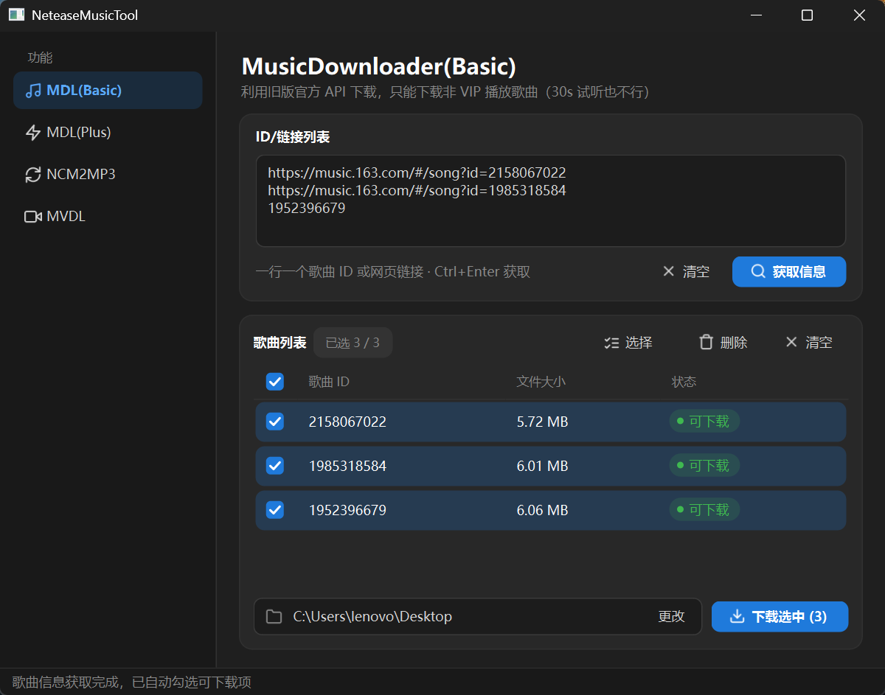
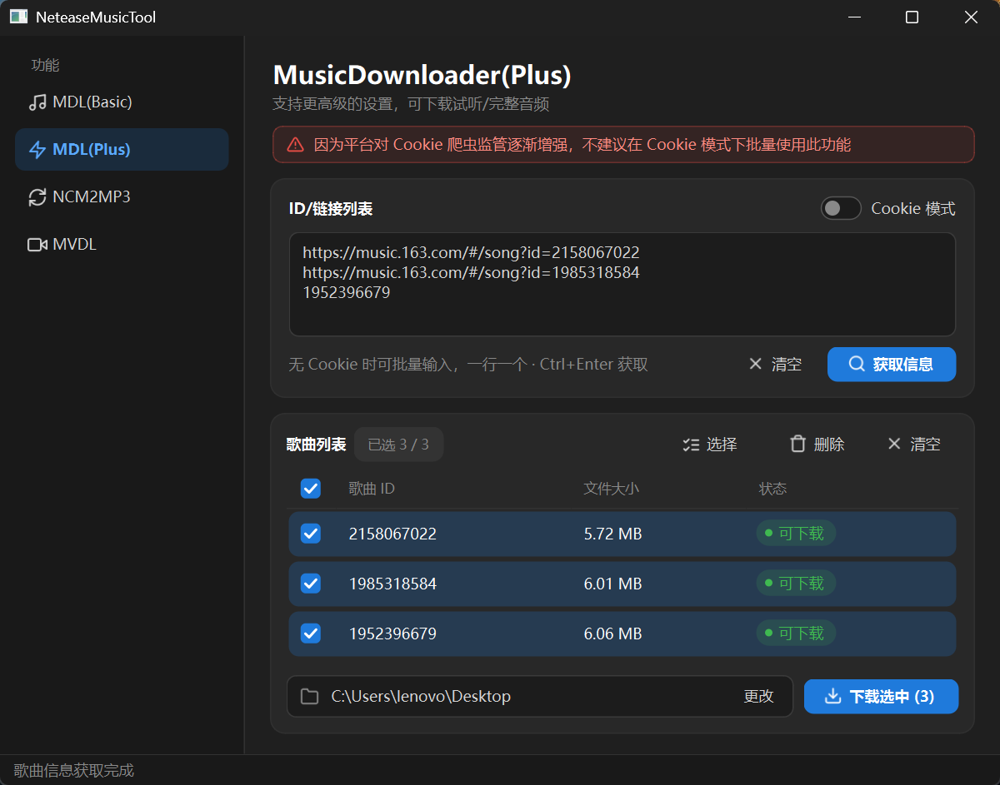
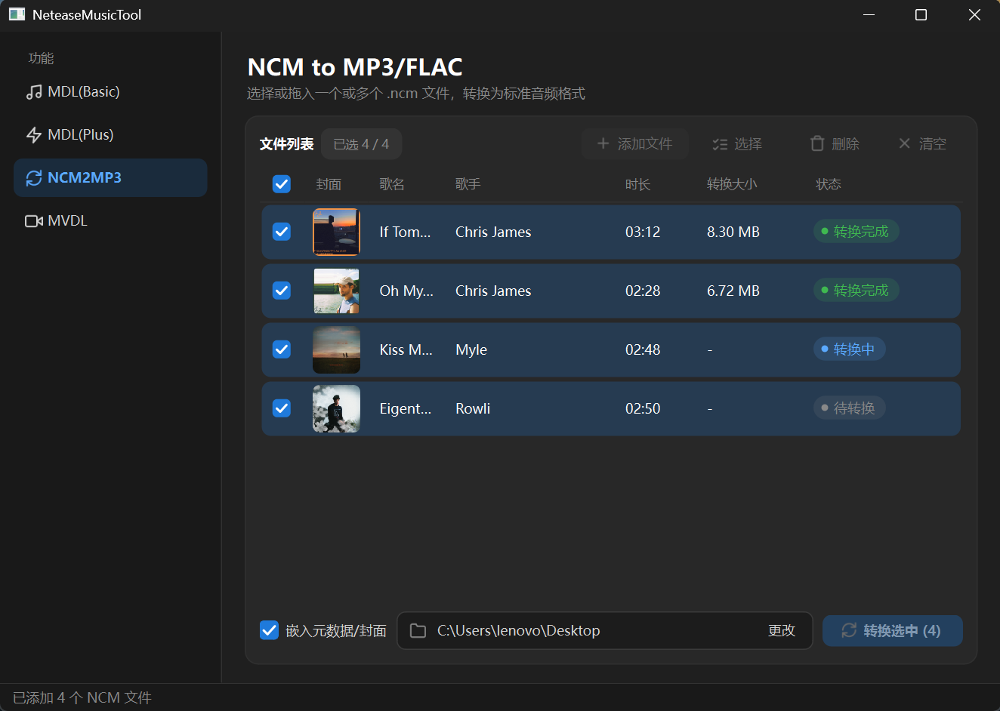
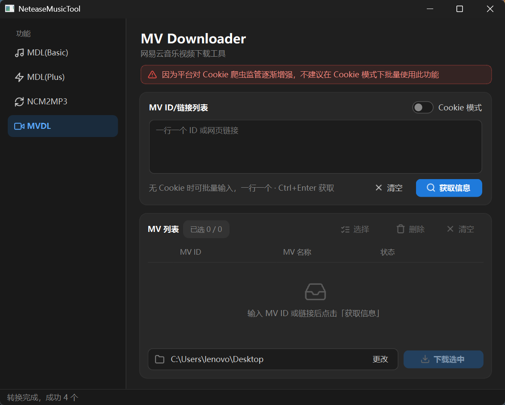
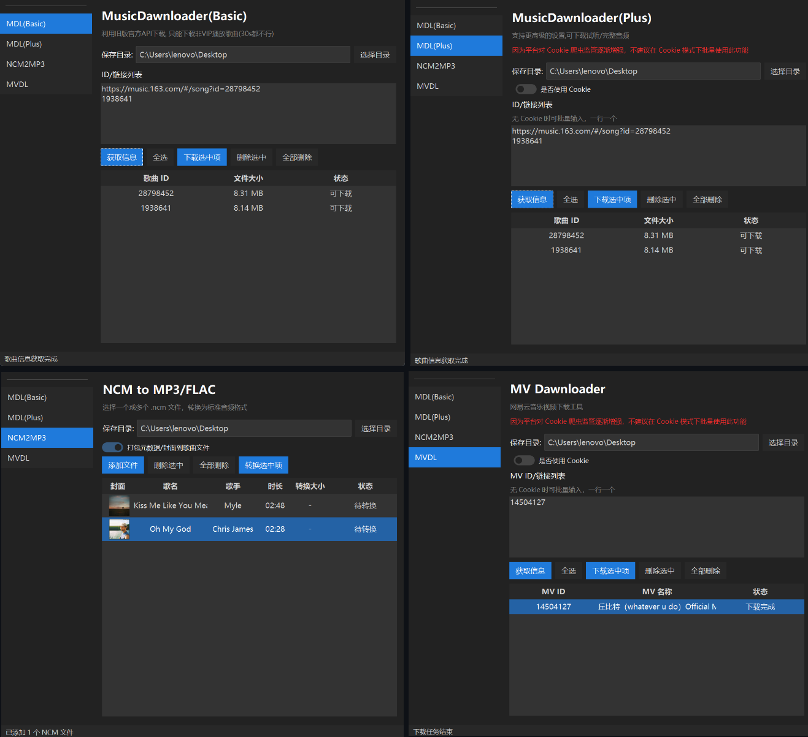

#  Neatease Music Tool

基于 Python 的网易云音乐工具, 它的功能包括:

- 通过歌曲ID或网页URL下载

- 通过Cookie或访客形式下载歌曲或MV(Cookie模式不推荐批量)

- NCM文件解析(支持打包元数据)

> [!Important]
> 使用本项目时请务必遵守相关法律法规, 遵守`MIT`协议, 尊重网易云音乐的服务条款

> [!Info]
> Ver3.2 重写了 ui，用 QT 替换了原来的，核心逻辑未改变

### MDL Basic

基于开放式API, 只能下载网页可预览式的曲目，对于VIP歌曲连30秒试听都下载不了

### MDL Plus

Basic的升级版, 利用了模拟安卓端的 eapi，参考了NetEase cloud music API这个项目的解密方法

加入了 Cookie 功能，可通过登录 Cookie 下载VIP歌曲

### NCM2MP3

NCM解密工具，可以解析并还原元数据，支持批量

### MVDL

MV下载器，也是利用了模拟安卓端的 eapi，可利用 Cookie 登录来获取更高画质

### 旧版 UI (Ver2.1)

